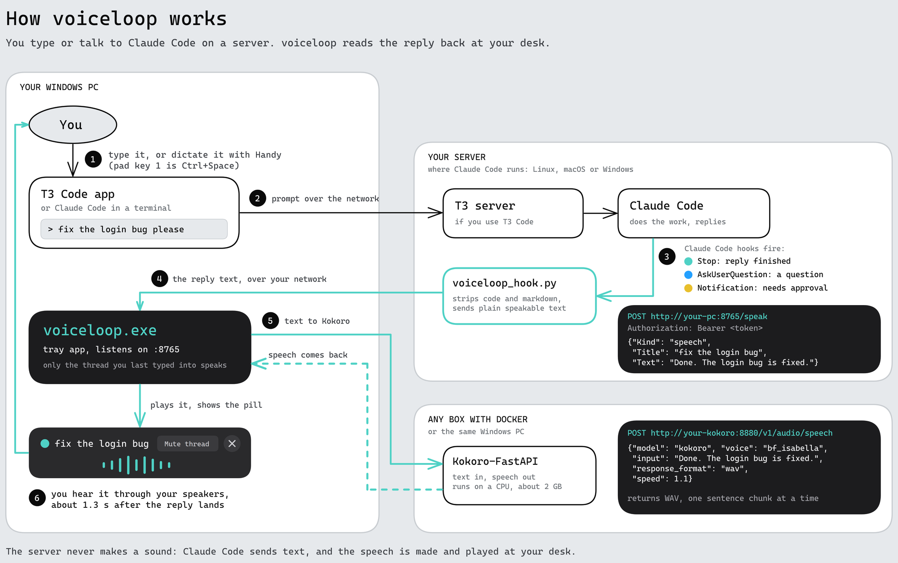
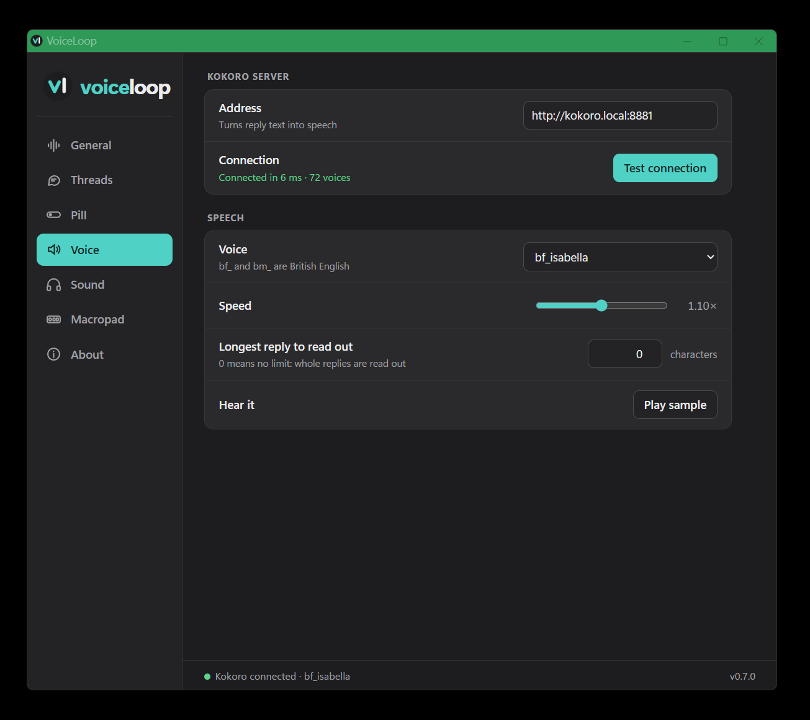
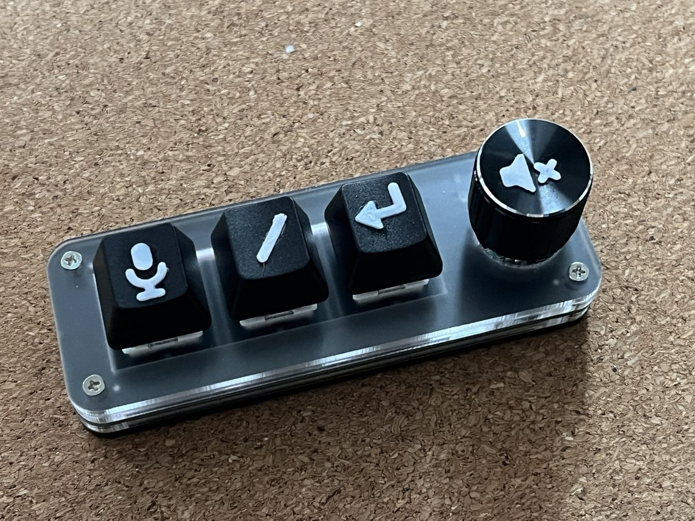

# voiceloop

**voiceloop** reads Claude Code's replies aloud on your Windows PC, even when Claude Code runs on a different machine.

A small hook in Claude Code sends each finished reply to `voiceloop.exe` on your desk PC. **voiceloop** turns the text into speech with [Kokoro](docs/kokoro.md), plays it, and shows a small pill on screen while it talks. Questions and permission prompts get their own chimes, so you can look away while an agent works and still know when it needs you.



## What it does

- Speaks each reply once Claude finishes, and starts talking about 1.3 s after the reply arrives, even for long replies.
- Plays three rising notes before reading out a question (`AskUserQuestion`), and a ding-dong-ding for permission prompts.
- Skips code blocks, tables and URLs, and reads `/resend` as "slash resend" and `~/code/project` as "project".
- Handles many threads. By default only the thread you last typed into speaks. You can mute a thread with `/mute`, or have every unmuted thread speak in turn.
- Reads the last reply again when you type `/resend` (or `/repeat`).
- Stays quiet while the PC is locked.
- Ctrl+Alt+V turns voice mode on or off, and Ctrl+Alt+X stops speech.
- Sets up the macropad (see [The macropad](#the-macropad)) from its Settings panel, with no vendor software. It can also export key symbols as an STL file for 3D printing.

## How it fits together

The diagram at the top shows the whole loop:

1. You type a prompt, or dictate it with Handy, in T3 Code or Claude Code on your Windows PC.
2. The prompt goes to Claude Code on your server, through the T3 server if you use T3 Code.
3. When Claude finishes a reply, asks a question or needs your approval, Claude Code runs `voiceloop_hook.py` through its hooks (`Stop`, `PreToolUse` for `AskUserQuestion`, and `Notification`).
4. The hook strips code and markdown and sends the plain text to `voiceloop.exe` on your PC: a `POST /speak` on port 8765 with your token.
5. `voiceloop.exe` sends the text to Kokoro (`POST /v1/audio/speech`) one sentence chunk at a time and gets WAV audio back.
6. It plays the audio through your speakers and shows the pill while it talks.

The server never plays anything: Claude Code only sends text, and the speech is made and played at your desk.

All three can be the same Windows PC. **voiceloop** was built for the split case: Claude Code on a headless server, you at a desk, and speech made on whatever box has spare CPU.

| Part | Runs on | Needs |
|---|---|---|
| `voiceloop.exe` | Windows 10 or 11, 64-bit (tested on 11) | Nothing else. It's a single 9 MB exe |
| `hooks/voiceloop_hook.py` | Anywhere Claude Code runs | Python 3.8 or later, standard library only |
| Kokoro, or another speech server | Any machine with Docker | About 2 GB of memory for Kokoro. A CPU is enough |

## Install

### 1. Start Kokoro

Follow [docs/kokoro.md](docs/kokoro.md). In short, run `docker compose up -d` in the `kokoro/` folder and check that `http://that-box:8880/health` answers.

Already run another speech server with an OpenAI-style `/v1/audio/speech` endpoint, such as Speaches? That works too. See [Other speech servers](docs/kokoro.md#other-speech-servers).

### 2. Install voiceloop on the Windows PC

1. Download `voiceloop-<version>-windows.zip` from [Releases](https://github.com/Tombo1001/voiceloop/releases) and unzip it.
2. Right-click `install.ps1`, choose **Run with PowerShell**, and allow it. To let only your Claude Code machine through the firewall, run it from an administrator PowerShell instead: `powershell -ExecutionPolicy Bypass -File install.ps1 -HookFrom 192.168.1.20`.
3. Settings opens. Under **Voice**, enter Kokoro's address (`http://127.0.0.1:8880` if it runs on this PC), press **Test connection**, and pick a voice.

   

The exe isn't code-signed, so Windows SmartScreen may say it "protected your PC". Choose **More info**, then **Run anyway**. Each release lists the exe's SHA256 so you can check the download first.

**voiceloop** lives in `%LOCALAPPDATA%\VoiceLoop`, starts when you log on, and has a Start menu entry. To remove it, run `install.ps1 -Uninstall`.

### 3. Pair the hook

On the machine that runs Claude Code:

1. Clone this repo, or copy `hooks/voiceloop_hook.py` somewhere it can stay.
2. In **voiceloop**, open Settings, **About**, pick the address your Claude Code machine can reach, and press **Copy command**.
3. Paste and run that command next to `voiceloop_hook.py`. It looks like this:

   ```bash
   python3 voiceloop_hook.py setup --url http://192.168.1.50:8765 --token 3f9c...
   ```

   It saves the address and token to `~/.config/voiceloop/hook.json` (`%APPDATA%\VoiceLoop` on Windows), adds four hooks to `~/.claude/settings.json` after a dated backup, and sends a test phrase. You should hear it.
4. Start a new Claude Code session. Replies are now read out.

`python3 voiceloop_hook.py test` sends the test phrase again. `python3 voiceloop_hook.py remove` takes the hooks back out of `settings.json`.

## Using it

- **Threads.** If you use [T3 Code](https://github.com/pingdotgg/t3code), the pill shows the T3 thread's name. With plain Claude Code it shows the project folder. Settings, **Threads** lists the threads **voiceloop** has heard and lets you mute each one.
- **Commands.** Type these in Claude Code. **voiceloop** handles them, and Claude never sees them.
  - `/mute` and `/unmute` mute or unmute the current thread.
  - `/resend`, `/repeat` and `/replay` read the last reply again.

  Dictating "slash mute" works too.
- **The pill.** It shows while **voiceloop** speaks. Its bars follow the speech, and the ✕ stops playback. Settings, **Pill** sets its monitor, corner, size and colours.
- **Length.** **voiceloop** reads up to 600 characters of a reply by default, about 40 seconds, and stops at a full stop. Change it in Settings, **Voice**.
- **Settings backup.** Settings, **General** exports every setting and the mute list to a file and imports them again. The token is never included.

## The macropad



**voiceloop** was built around a cheap 3-key USB pad with a knob. Its default key map:

| Control | Does |
|---|---|
| Key 1 | Ctrl+Space, to start dictation in [Handy](https://github.com/cjpais/Handy) |
| Key 2 | Starts dictation and types `/`, for slash commands |
| Key 3 | Enter, to send |
| Knob turn | Volume down and up |
| Knob press | Stop speech |

**[Get the pad on Amazon UK](https://link.amazon/B0bSXFqie)**. As an Amazon Associate I earn from qualifying purchases. The same pad sells under many brand names, so if that listing is gone, search for a "3 key macropad with knob" and check that its USB ID is `1189:8890` once it's plugged in.

Settings, **Macropad** shows a drawing of the pad. Pick an action for each key and the knob, then press **Upload to pad**. The key map lives on the pad itself, so it works on any PC afterwards. **voiceloop** writes to the pad through Windows' own HID driver: no driver to install and no admin rights.

**Key symbols.** The same tab makes flat symbols to print and glue onto the keys. Pick an icon for each key (starter icons are included), then **Export STL…**. They printed cleanly at 9 mm with two 0.2 mm layers of PLA.

**Pad profiles.** Each pad model is described by an XML pad profile: its USB IDs, keys, knobs, light modes and key map. The schema is [`listener/pads/pad-profile.xsd`](listener/pads/pad-profile.xsd) and the built-in profile is [`listener/pads/ch57x-3key-knob.xml`](listener/pads/ch57x-3key-knob.xml). To support another CH57x pad that speaks the same protocol, export the profile, edit the IDs and codes, and import it. An exported profile carries any key icons you added yourself, so importing it on another PC brings the symbols with it. **voiceloop** only speaks the `ch57x-8890` protocol so far. If your pad uses another, [open an issue](https://github.com/Tombo1001/voiceloop/issues/new?template=pad-support.yml).

### Dictation

**voiceloop** doesn't do speech-to-text. [Handy](https://github.com/cjpais/Handy) (MIT-licensed, [download](https://github.com/cjpais/Handy/releases)) is a free, local dictation app that pastes what you say into the focused window. **voiceloop** reads Handy's shortcut from its settings, so the pad's Dictate actions use whatever you've set (Ctrl+Space by default). If you change Handy's shortcut later, Settings, **Macropad** offers to update the pad. With another dictation tool, pick **Custom keys…** for key 1 and type its shortcut.

If you send with the pad's Enter key, turn Handy's auto-submit off (Handy's **Advanced** settings, **Auto Submit**: Off), so you can check the text before it goes. Handy is optional, and any dictation tool that types into the focused window will do.

## Compared with VoiceMode

[VoiceMode](https://github.com/mbailey/voicemode) is the best-known voice add-on for Claude Code, and it does more than **voiceloop** in one direction: two-way spoken conversation over MCP, with speech-to-text built in. If you work on one machine and want to talk with Claude, try it first.

**voiceloop** does less, and aims to do these things better:

- **Playback on a different machine from the agent.** VoiceMode plays audio where Claude Code runs. **voiceloop** is built for Claude Code on a server and sound at your desk.
- **A native Windows client**, with a tray icon, an on-screen pill, per-device output and mute while locked.
- **Per-thread control** for people running several agents at once: mute threads, hear only the current one, or queue them all.
- **The macropad**: dictate, send and stop speech with one hand, set up from **voiceloop**.

**voiceloop** only speaks replies. It doesn't listen, so it leaves dictation to Handy or something like it.

## Security

- The hook sends replies to **voiceloop** over plain HTTP, with the token as a bearer header. Keep **voiceloop** on a LAN or a tailnet, never on a port open to the internet. Use `-HookFrom` so the firewall only lets the Claude Code machine in.
- Anyone with the token can make the PC speak and mute threads. It's in `config.json` in the install folder, and in `hook.json` (mode 0600) on the Claude Code machine.
- The Settings panel listens on `127.0.0.1:8766` only. Each run makes a random key that the page needs, and the server checks the Host header.
- The hook reads T3 Code's database read-only, to find thread names. It sends nothing anywhere except to the **voiceloop** address you gave it.
- Kokoro-FastAPI has no authentication, so keep it off the internet too. If your speech server takes an API key, it's stored in the settings on the PC and left out of settings exports.

## Building from source

The listener is pure Go with no cgo, so it builds on Linux, macOS or Windows:

```bash
cd listener
go test ./...                 # runs on any OS; Windows-only files are build-tagged
go run ./tools/mkrsrc         # writes the exe icon and version info
GOOS=windows GOARCH=amd64 CGO_ENABLED=0 go build -trimpath -ldflags "-s -w -H windowsgui" -o voiceloop.exe .
```

`tools/ui-mock/mock.py` serves the Settings panel with a fake API, so you can work on `listener/ui.html` without Windows: `python3 tools/ui-mock/mock.py listener/ui.html 8790`, then open `http://localhost:8790/?k=x`.

See [CONTRIBUTING.md](CONTRIBUTING.md) and [CHANGELOG.md](CHANGELOG.md).

## Credits

The macropad protocol is ported from [ch57x-keyboard-tool](https://github.com/kriomant/ch57x-keyboard-tool) by kriomant (MIT or Apache-2.0). Speech comes from [Kokoro-FastAPI](https://github.com/remsky/Kokoro-FastAPI). [THIRD-PARTY-NOTICES.md](THIRD-PARTY-NOTICES.md) has the licences.

**voiceloop** is MIT-licensed. It isn't made by or affiliated with Anthropic.
